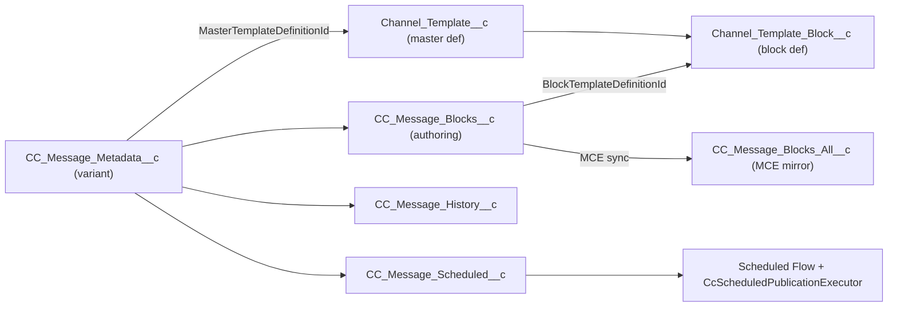

---
todos:
  - id: p0
    status: in_progress
    content: 'Phase 0: delete orphan LWCs, fix failing test, write JSON boilerplate v1 + binding syntax docs'
  - id: p1
    content: 'Phase 1: additive data model (Metadata/Blocks fields, Channel_Template_Block__c, CC_Message_History__c, CC_Message_Scheduled__c, Live status, FLS)'
    status: pending
  - id: p2
    content: 'Phase 2: shared ccTemplateSchema/Parser/Renderer modules with legacy migration + Jest tests; remove duplicate regex parsers'
    status: pending
  - id: p3
    content: 'Phase 3: 4-step template wizard, section/content binding editors, CcTemplateValidator activation + block delete guard'
    status: pending
  - id: p4
    content: 'Phase 4: editor on CC_Message_Blocks__c ContentJson via CcMessageContentService + Canvas_Blocks migration batch'
    status: pending
  - id: p5
    content: 'Phase 5: CcMessageLifecycleService cockpit actions with guards, history, MCE sync re-point, scheduled Flow executor'
    status: pending
  - id: p6
    content: 'Phase 6: destructive cleanup of duplicate/legacy fields and VersionHistoryLog after backup'
    status: pending
name: Copy Center Template Refactor
overview: 'A phased, low-risk refactor of Copy Center and the Master Template binding. It is grounded in the current sandbox state (154 message metadata rows, 113 MCE block mirrors, 14 rows in the unused CC_Message_Blocks__c, 2 Channel_Template__c, 26 version logs). Each phase is small, deployable on its own, and written so a simpler model can execute it with the prompt included.'
isProject: false
---
# Copy Center and Master Template Refactor Plan

## 1. Current state (verified in repo and sandbox)

**Template side (Marketing Dictionary > Channel > Templates)**
- The live UI is [force-app/main/default/lwc/masterTemplateStudio](force-app/main/default/lwc/masterTemplateStudio) plus `templateStudioUtils.js`. It is embedded in `marketingDictionaryChannelTab` when `Use_Templates__c` is set.
- Orphaned or unwired components:
  - `channelTemplateManager` (about 1000 lines) is not used.
  - `masterTemplateSettingsBindings` and `blockLayoutStudio` are not wired in, and the Content Blocks binding tabs are stubs.
- `Channel_Template__c`:
  - `Country_Code__c` is a hardcoded Text(8) list (PL, RO, ...) and does not use dictionary locales.
  - `Manifest_JSON__c` holds schema 2.0 `components[]` / `shellBindings[]`.
  - HTML is stored as ContentVersion files with `[SHELL_HTML]` / `[CONTENT_BLOCK]` prefixes.
- The region/binding parser exists three times, all regex-based:
  - `copyTemplatePreview.js` (about 1050 lines)
  - `templateStudioUtils.js`
  - Apex `scanCcPreviewRegionsInOrder` in [ChannelTemplateController.cls](force-app/main/default/classes/ChannelTemplateController.cls) (1900 lines)
- Content and settings support is incomplete:
  - There are no Bullet List or Divider editors.
  - The palette types are hardcoded.
  - Margin tokens are missing.
  - The file guards in `ChannelTemplateManifestService.cls` are no-ops.

**Copy Center side**
- There is no master record. A "master" is just a grouping by `MessageName__c`.
- `createMessage` inserts only one `CC_Message_Metadata__c` row. It writes no blocks and no history.
- `Status__c` values are Draft/Ready/Published/Inactive/Archived. The editor uses different labels (Active, Draft Scheduled).
  - Sandbox data: 128 Draft, 2 Published, 1 Inactive, 23 null.
- `IsActive` and `Published_At` are never set by the cockpit.
- Scheduling exists in the UI only; nothing executes it.
- The editor writes `Canvas_Blocks_JSON__c`.
  - Outbound sync maps it to the MCE data extension field `MessagePropertiesJSON`.
  - Inbound sync maps it back into the `MessagePropertiesJSON__c` fields, so the round trip is broken.
- Block objects:
  - `CC_Message_Blocks_All__c` (113 rows) is the live MCE block mirror.
  - `CC_Message_Blocks__c` (14 rows) has an identical schema and is not used by any code.
- Versioning is unfinished:
  - `CC_Message_VersionHistoryLog__c` (26 rows) is unused.
  - `CC_Message_Versions__c` is referenced in code but missing from the org.
  - `CC_Message_History__c` and `CC_Message_Scheduled__c` do not exist.
- `CC_Message_Metadata__c` has 93 fields, including many duplicate camelCase/snake_case pairs. Some pairs have conflicting types, for example `DisplayProbabilityManual__c` is a Checkbox while `Display_Probability_Manual__c` is a Number.
- Gaps in rules and code:
  - Delete has no guard for Live messages or messages used by campaigns.
  - "Change Source Template" does no compatibility check.
  - Clone naming uses `_` while create uses `-`.
  - `CcMirrorObjectMap` expects a `CC_External_Key__c` field that is missing.

## 2. Architecture decisions (defaults; override before Phase 1)

1. **One canonical content contract.** `CopyCenterJsonBoilerplate` schema v1 is the only content format.
   - It is stored per block in `CC_Message_Blocks__c.ContentJson__c` (+ `ContentJsonPart2__c`).
   - The template definition stores the same shape with empty content and only the binding flags.
   - Every JSON root carries `schemaVersion`.
2. **One parser and one model module, shared by everything.**
   - New LWC service modules:
     - `ccTemplateSchema`: types, defaults, validation, migrations.
     - `ccTemplateParser`: parses with `DOMParser`, not regex.
     - `ccTemplateRenderer`: merges JSON into HTML for preview and publish.
   - The studio, the editor, and the preview all import these modules.
   - Apex keeps only server-side validation, through `CcTemplateValidator.cls`, against the same JSON rules.
3. **Template definition storage.**
   - Keep `Channel_Template__c` as the Master Template Definition.
   - Add a child object `Channel_Template_Block__c` (Block Template Definition). Blocks need their own status, usage counts, and delete guards, and a single manifest JSON makes those fragile.
4. **Block storage roles.**
   - `CC_Message_Blocks__c` becomes the authoring object, holding the block rows of a message variant version.
   - `CC_Message_Blocks_All__c` stays the read-only MCE mirror.
   - The 14 existing `CC_Message_Blocks__c` rows are test data and get deleted.
5. **Statuses.** `Status__c` becomes Draft / Ready / Live / Inactive / Archived.
   - Published is renamed to Live. Only 2 rows are affected.
   - `IsActive__c` becomes a formula `Status__c = 'Live'`, so the two values can never disagree.
6. **History.** Create a new `CC_Message_History__c` object for an append-only audit and version log.
   - Migrate the 26 `CC_Message_VersionHistoryLog__c` rows into it, then delete the old object.
   - Remove the `CC_Message_Versions__c` references.
7. **Scheduling.** Create a new `CC_Message_Scheduled__c` object, executed by a Scheduled-Triggered Flow every 15 minutes.
   - The Flow calls an invocable Apex method, `CcScheduledPublicationExecutor`, so the logic stays testable.
8. **Duplicate field cleanup** is its own phase (Phase 6), done after sync is re-pointed. Never delete a field in the same deploy as the code change that stops using it.



## 3. Phases

Each phase ends with Apex tests passing, a sandbox deploy, and a PR stacked on the previous phase. Run the related test classes with `sf apex run test --tests`.

### Phase 0: Safety net (no behavior change)
- Delete the orphan LWCs: `channelTemplateManager`, `masterTemplateSettingsBindings`, `blockLayoutStudio`. First check with `rg` that nothing references them.
- Fix the existing failing test `productTypeWithProductsCannotBeDeleted`, so deploys can run with `RunLocalTests`.
- Add `docs/copy-center/CopyCenterJsonBoilerplate.v1.json` and `docs/copy-center/binding-syntax.md`. Together these are the contract every later phase follows.

### Phase 1: Data model additions (additive only)

On `CC_Message_Metadata__c`, add:
- `MasterTemplateDefinitionId__c` (Lookup to Channel_Template__c)
- `MCE_MasterTemplateAssetId__c`
- `MCE_MasterTemplateAssetPath__c`
- `MCN_MasterTemplateAssetId__c`
- `MCN_MasterTemplateAssetPath__c`
- `CurrentMessageVariantVersionNumber__c` (Number)
- The `Live` picklist value

On `CC_Message_Blocks__c`, add:
- `Message_Metadata__c` (MD)
- `BlockTemplateDefinitionId__c` (Lookup to Channel_Template_Block__c)
- `BlockTemplateDefinitionName__c`
- `BlockContentTypes__c` (multi-select: RichText, Image, BulletList, Divider, Button)
- `MCE_BlockAssetId__c` and `MCE_BlockAssetPath__c`
- `MCN_BlockAssetId__c` and `MCN_BlockAssetPath__c`
- `ContentJson__c` and `ContentJsonPart2__c` (Long Text Area 131072)
- `MessageBlockOrder__c`
- `MessageVariantVersionId__c`

On `Channel_Template__c`, add:
- `Locale__c` (Lookup to the Marketing_Dictionary__c locale)
- `Template_Mode__c` (Single Block / Multi Block)
- `Definition_JSON__c`

New `Channel_Template_Block__c` object:
- Template MD, Name, Status (Draft / Ready / Active), Order, Description
- `Definition_JSON__c`, Content types, `Validation_Status__c`, `Validation_Message__c`

New `CC_Message_History__c` object:
- Message MD, Version Number, Action (Created / Updated / StatusChanged / Synced / TemplateChanged / Scheduled / Deleted)
- Snapshot JSON, Status From/To, Actor, Timestamp

New `CC_Message_Scheduled__c` object:
- Message lookup, Action (Publish / Unpublish / Archive), Run At, Status (Pending / Done / Failed / Cancelled), Error, Executed At

Other changes:
- Grant FLS in `ClientActivationCenter.permissionset-meta.xml`.
- Add `CC_External_Key__c` (External Id), or remove it from `CcMirrorObjectMap`; decide after a quick `rg`.

### Phase 2: Shared schema, parser and renderer modules
- New LWC modules `ccTemplateSchema`, `ccTemplateParser`, `ccTemplateRenderer`.
- Supported tokens and regions:
  - Section settings for container/row/column: padding and margin (with chain-all), bg color, gradient (with fallback), bg image desktop/mobile (size, repeat, position), hide desktop/mobile, column direction.
  - Regions `fixed-read`, `fixed-edit`, and `blocks`.
  - The 5 content types.
- Keep backward-compatible reading of the existing `cc-preview` / `binding-*` markers and `blo-pad-dsk` style tokens. Map them to schema v1 in one `migrateLegacy()` function.
- Jest tests for parser round trips and legacy migration. Add `sfdx-lwc-jest` if it is missing.
- Re-point `copyTemplatePreview.js` and `templateStudioUtils.js` to these modules, then delete their duplicate regex code.

### Phase 3: Template wizard (masterTemplateStudio refactor)
- Four steps:
  1. Locale (dictionary locales via `salesforceLocalePicker` / dictionary), name, classification, description, and single vs multi block.
  2. Shell HTML upload, with CSS inlining via the existing inliner (or `juice`-like logic), then parse.
  3. Content blocks (multi-block only): upload or define blocks into `Channel_Template_Block__c`, and edit section and content bindings.
  4. Summary, validation, and preview in desktop/mobile and light/dark.
- New child components, each under 400 lines: `ccSectionSettingsEditor`, `ccContentBindingEditor` (one sub-panel per content type), `ccSpacingInput` (chain-all), `ccBackgroundInput`.
- Apex:
  - `CcTemplateValidator.cls` handles activation. A template or block can only be activated when it is valid.
  - Deleting a block is blocked when any `CC_Message_Blocks__c` row references it.
  - Editing an Active block is allowed after a warning dialog.

### Phase 4: Copy Center editor alignment
- `copyCockpitEditor` reads and writes `CC_Message_Blocks__c.ContentJson__c` rows, ordered by `MessageBlockOrder__c`, through new Apex `CcMessageContentService.cls`.
- That service splits JSON over Part2 when it exceeds 131072 characters, and validates against the template definition.
- One-time migration batch `CcCanvasBlocksMigrationBatch` converts `Canvas_Blocks_JSON__c` into block rows for the existing 154 messages. The old field stays readable until Phase 6.

### Phase 5: Cockpit actions with guards
- All actions go through one service, `CcMessageLifecycleService.cls`. Each action writes a `CC_Message_History__c` row and runs in one transaction with `FOR UPDATE` on the master group.
- Actions and their rules:
  - Create as New Message Definition
  - Create as New Message Variant (same `MessageName__c`; naming fixed to hyphen in `copyMessageNaming.js`)
  - Create New Variant Version: copies the blocks and increments `CurrentMessageVariantVersionNumber__c`.
  - Change Source Template: compatibility check using block definition names, types, and order. It returns a diff the user must confirm.
  - Sync with MCE: re-point `MarketingCloudCopySync` to build the DE payload from blocks JSON and the MCE/MCN asset fields.
  - Schedule Publication: no overlapping pending schedule, and Run At must be in the future.
  - Delete: blocked when the message is Live, linked to a campaign through `CampaignCopyVariantHandler`, or has pending schedules. Use the same dependency-report pattern as `MarketingDictionaryDeleteGuard`.
- Scheduled Flow plus `CcScheduledPublicationExecutor` (invocable, bulk-safe, sets the status and `Published_At__c`).

### Phase 6: Cleanup (destructive, separate deploy)
- Remove the duplicate snake/camel fields after `rg` confirms they are unused. Keep the one that MCE sync uses, and record the mapping in `docs/copy-center/field-map.md`.
- Remove `MessagePropertiesJSON__c`, `MessagePropertiesJSON2__c`, and (after the migration has been verified) `Canvas_Blocks_JSON__c`.
- Remove the `Published` picklist value and `CC_Message_VersionHistoryLog__c`, after migrating them.
- Use `destructiveChangesPost.xml`. Back up first: `sf data export tree` of the affected objects.

## 4. Execution rules for simpler models (paste at the top of every phase prompt)

```text
You are executing Phase N of docs/copy-center/PLAN.md in a Salesforce DX repo.
Rules:
- Only touch files listed for this phase. Read each file before editing.
- Contract: docs/copy-center/CopyCenterJsonBoilerplate.v1.json and binding-syntax.md. Do not invent fields.
- Before removing/renaming anything: rg the whole repo (classes, lwc, flows, objects, permissionsets, layouts) and list usages.
- Apex: bulk-safe, with sharing, AuraHandledException with setMessage, >=85% coverage, one test class per service.
- LWC: no component over ~500 lines; logic in service modules; non-cacheable imperative loads after writes.
- Deploy: sf project deploy start -o filip.augustyniak.ext@unicredit.be --test-level RunSpecifiedTests --tests <related tests>.
- Finish: summary of changed files, test results, open risks. Do not start the next phase.
```

## 5. Key risks
- `MarketingCloudCopySync` and `MCEContentCenterHourlySync*` depend on the duplicate fields. Map every field in Phase 4 before deleting anything in Phase 6.
- The existing 154 messages have no template link, so `MasterTemplateDefinitionId__c` stays optional and the editor falls back to legacy mode when it is blank.
- The DOMParser behaves differently in Apex. Apex therefore validates only JSON and never parses HTML.
